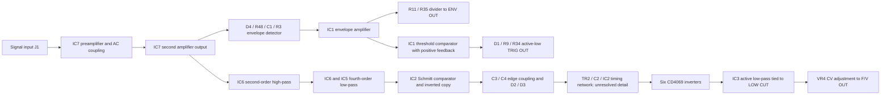

# KLM-129 schematic map

Status: research draft, 2026-11-06. Routing below is supported by direct visual inspection; the F/V timing subcircuit has an unresolved drawing conflict. The user approved a documented reduced timing model on 2026-11-06; see circuit-assumptions.md. This is not a verified full netlist or a hardware-validated model. Source keys and page numbering are in references.md.

## Functional routing

Periodicity2 is a new digital branch using same-direction crossing intervals. It is not a Korg circuit stage and does not sit in the F/V signal path.

## Connection table

All references in this table are to S1 PDF page 5, bottom KLM-129 panel, unless specified.

| Source | Destination | Interpretation / confidence |
|---|---|---|
| J1 through R51 | IC7 pin 2 summing input | Inverting preamp; VR7/R53/C17 feedback, high |
| IC7 pin 1 | opposed C16/C15 coupling, R50, IC7 pin 6 | AC-coupled second inverting amplifier, high |
| IC7 pin 7 | R55 / R56 / C12 / C10 / R52 / R45 / VR6 and IC6 pins 2/3/1 | Active high-pass input, high |
| IC7 pin 7 | D4 then R48 and C1 | Unfiltered amplitude branch, high |
| IC7 pin 7 | R47 / R46, J9 | Attenuated amplifier output, high |
| IC6 pin 1 | R44, two VR5 sections, R42, C8/C9, IC6 pins 5/6/7 | First low-pass biquad, high |
| IC6 pin 7 | R43, two VR5 sections, R41, C5/C7, IC5 pins 3/2/1 | Second low-pass biquad, high |
| IC5 pin 1 | R39 / R40 to J17 and R33 to IC2 pin 4 | Filter output and F/V detector input, high |
| IC2 pin 2 | R29 feedback to pin 5; pin 6 of next comparator; C3 | Hysteretic first stage plus inverted copy, high |
| IC2 pin 1 | C4 | Opposite-phase edge drive, high |
| C3/C4 | D2/D3 through R12/R14 to TR2 base | Positive transitions from each phase drive TR2, high |
| TR2 collector | C2 top and IC2 pin 8 | Timing capacitor reset, high |
| C2 / R16 / R23 / R24 / R25 / VR2 / R26 / R27 / R32 | Last two IC2 sections and IC4 input | Coupled timing/calibration network; exact final comparator wiring UNVERIFIED |
| IC4 pins 1→2→3→4→5→6→9→8→11→10→13→12 | R37 / two VR6 sections / R54 / C11 / C6 / IC3 | Even-numbered inverter chain followed by active smoothing, high topology confidence; supply levels unverified |
| IC3 pin 6 | R36, VR4, R38, J18 | CV adjustment and output loading, high |
| C1 top | IC1 pin 3 and R3 to ground | Half-wave storage with resistive release, high |
| IC1 pin 1 | R4 feedback, IC1 pin 6, R11, peak LED transistor network | Internal envelope; gain nominally 2 from R4/R2, high |
| R11 / R35 junction | J29 | Unloaded ENV OUT is half the internal envelope, high |
| VR3 wiper via R21, output pin 7 via R19 | IC1 pin 5 | Adjustable threshold with hysteresis, high |
| IC1 pin 7 | D1 / R9 / R34, J30 | Inverted output: increasing envelope pulls trigger low, high |

## Consequential corrections to the initial implementation sketch

- Envelope uses a diode and storage capacitor. Full-wave absolute-value rectification is an optional digital algorithm, not this schematic's rectifier.
- Trigger compares the internal envelope before its output divider. Feeding EnvFollow2's normalized outlet is feasible only with an explicit inverse mapping to that internal level.
- LOW CUT is a four-gang control: two sections affect input high-pass filtering and two affect output smoothing. An independently chosen output smoothing time is a digital-mode convenience, not the original control relationship.
- HIGH CUT controls two cascaded active low-pass sections. One generic first-order low-pass does not reproduce this topology.
- Both conditioned signal edges can reset the timing network. Two events per clean sine cycle is the nominal event convention, not a guarantee for arbitrary audio or insufficient amplitude.

## Electrical uncertainty and approved reduction

Inspect the last IC2 triangle at the right of the timing block in both S1 p5 and S2 PDF p6. Its output label reads `3`, while the LM339's fourth output is pin 13 and pin 3 is its positive supply (D1 datasheet p4). The nearby vertical rail/input lines also cannot be accepted literally without resolving their intersections. Do not silently correct either issue. This blocks a verified pulse-width equation and a fixed circuit-mode Hz/V calibration. The branch map and digital event convention do not depend on resolving it.
